# 鹰眼 Hawkeye · 外部暴露面实时监控平台

**版本 `0.0.1`** · 后端 + 前端 + 规则库打成**一个可执行文件**，不需要 Go、不需要 Node、**没有任何配置文件**。

聚合网络空间测绘引擎，持续发现「本组织在公网上暴露了什么」，用 POC 判定 + AI 双重研判风险，
再用一块实时大屏呈现。数据大屏只是这个系统的一个展示视图（`/screen`），其余全部能力都是平台里的功能，
**所有业务参数都在「平台设置」页里改，保存即热生效**。

> **动手之前先读「合规与免责声明」**（本文靠后的那一节，`使用说明.md` 开头也有一份）：
> 这套工具只用于**自查自己被授权的资产**，把它跑起来、往范围里填东西、点发起，就等于接受那几条规则。

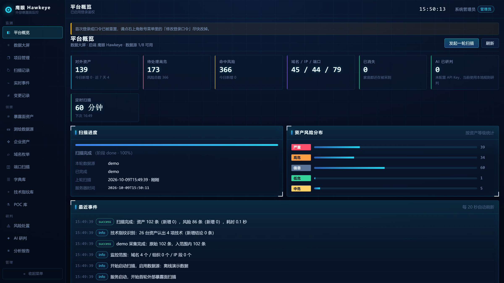

---

## 适合谁用

- 甲方安全 / 乙方交付里需要**持续**盯暴露面，而不是每季度做一次扫描的人；
- 手上有 FOFA / Hunter / Quake / ZoomEye / Shodan / Censys 的 Key，但只在 Excel 里躺着的团队；
- 想让「新上线了一个后台」这件事在当天就出现在待办里，而不是等下次渗透测试才发现的人。

它**不是**漏洞扫描器的替代品：判定来自测绘数据 + POC + AI，主动确认只做只读探测，写入型默认锁死（见下文闸门）。

---

## 三十秒跑起来

### 单文件（最常用）

从 Releases 下载对应平台的文件（`uname -m`：`x86_64` → amd64，`aarch64`/`arm64` → arm64）：

```bash
mv hawkeye-linux-amd64 hawkeye && chmod +x hawkeye
./hawkeye check-db -db ./data/hawkeye.db          # 建表自检，顺便报告各表数据量
./hawkeye serve    -db ./data/hawkeye.db -host 127.0.0.1 -port 8000
```

启动窗口会打印一次初始管理员口令，抄下来 → 打开 `http://127.0.0.1:8000/` 登录 → 立刻改口令。
`8000` 是本系统的默认端口，不写 `-port` 也是它；只有那台机器上 8000 已被别的程序占着，才显式换成别的。

Windows 用 `hawkeye-windows-amd64.exe serve -db D:\hawkeye\data\hawkeye.db -host 127.0.0.1 -port 8000`；
macOS 首次打开被拦时执行 `xattr -d com.apple.quarantine ./hawkeye`。

SQLite 与 PostgreSQL 都是纯 Go 驱动，交叉编译不需要目标平台的 C 工具链。

### 数据库

默认 SQLite 单文件；`-db-url postgres://...` 即切 PostgreSQL，同一套数据访问层按方言生成 SQL。
**要备份的只有这一个文件**：配置、账号、POC 库、指纹库、字典库、收集技能、资产、风险、变更历史、审计全在里面，程序本身不含状态。

---

## 第一次登录

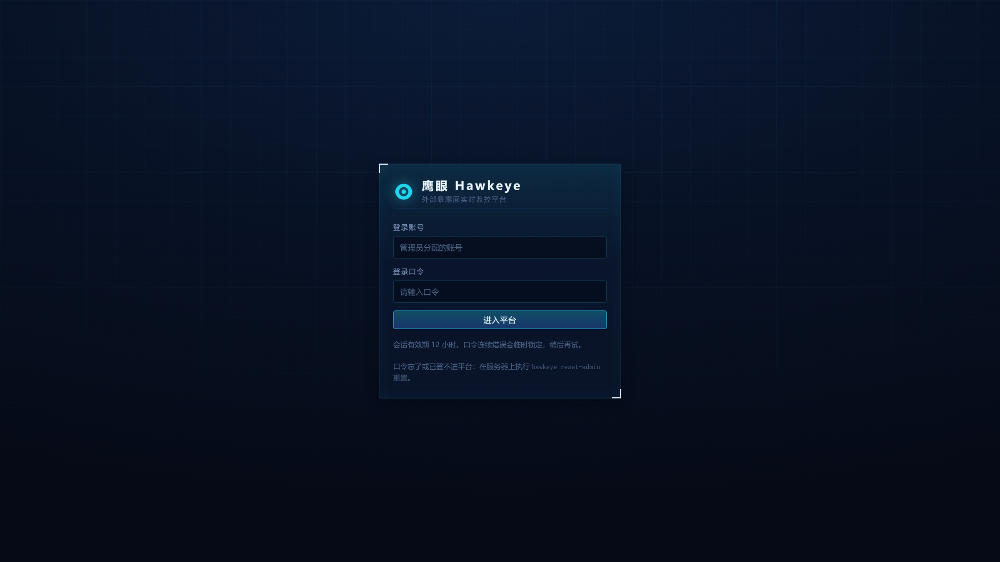

**任何监听地址都要凭据**，包括 `127.0.0.1` 和内网 IP——没有免鉴权模式，也没有「先本地开着配一配」的口子：

1. 账号表为空时，进程启动即创建 `admin`，口令随机生成，**只在运行窗口打印一次**；
2. 该口令标记为「待改口令」，登录后页面顶部持续提示，改完才消失；
3. 口令是 PBKDF2-SHA256（12 万次迭代 + 每账号独立盐），同一账号同一来源连续 6 次失败锁 10 分钟；
4. 忘了口令：`hawkeye reset-admin admin`（新口令打在终端，同时让该账号其他会话失效）。

---

## 权限模型

三级角色，前端裁剪入口、后端逐接口校验，**任何角色都不能超出自己那份权限**：

| 角色 | 能做什么 |
| --- | --- |
| `只读` viewer | 看页面、看详情、导出 CSV，以及 POC / 指纹的「仅校验」「试运行」和技能正文的「仅校验」（都不发包、不落库）。其余写接口一律不可见也不可调用 |
| `操作员` operator | 只读的全部 + 发起扫描、跑域名枚举、按项目方案侦察、拉取企业资产、执行收集技能（预演、单条真实试运行、发起一轮收集）、确认新增、改资产跟踪状态与风险处置状态、删除资产 |
| `管理员` admin | 全部功能：平台设置读写、账号管理、操作审计、清空数据，外加会改变系统行为的写操作——建/改/停用/删除项目、维护字典库、维护收集技能库（含成批导入）与删除发现台账、把技能发现并进监控范围、导入与启停 POC 和指纹、手动验证写入型 POC、把备案域名并进监控范围、测试通知发送 |

- 门禁在**后端逐接口**校验，前端只是把入口藏起来；只读角色直接 `curl` 那些写接口同样吃 403。
- 角色与账号状态是**每个请求现查**的：管理员把谁降级、停用或删号，那一边下一次请求就失效，不用等对方重新登录。
- 最后一个管理员不许降级、不许删除，避免把自己锁在门外。
- 登录、改密、建号、扫描、处置、改配置、清数据等动作全部写进操作审计，可按账号与动作筛选。

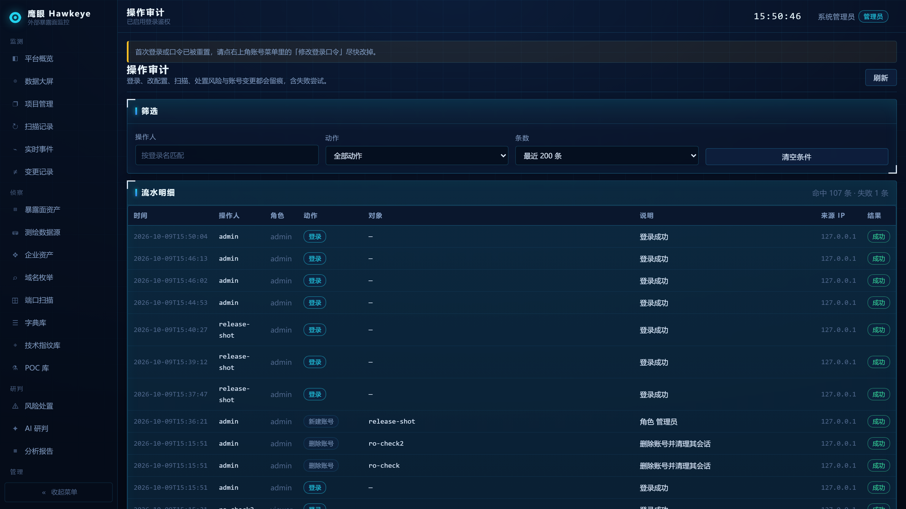

---

## 页面导览

导航按**监测 → 侦察 → 研判 → 管理**四段排开，一个功能一页。

### 项目：监控范围与查看范围都从它来

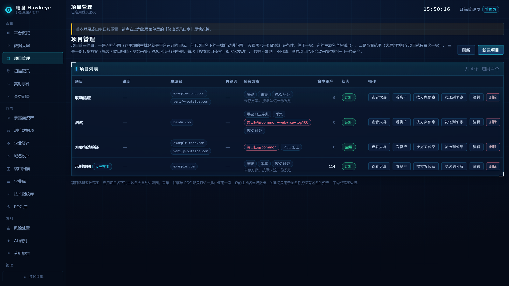

「项目管理」里建一个项目 = 定义**一块监控范围 + 一块查看范围**：主域名 + 兜底关键词 + 一份侦察方案。
启用即主域名自动进监控范围，停用当场撤出；采集、侦察、POC 验证与端口扫描都只打这一批。
新建/编辑时可以直接勾本轮跑哪几路（子域名爆破、端口扫描、测绘采集、POC 只读验证），存成项目上的「侦察方案」，
之后点「按方案侦察」每次都照它执行。

### 暴露面资产：按项目一对一查看

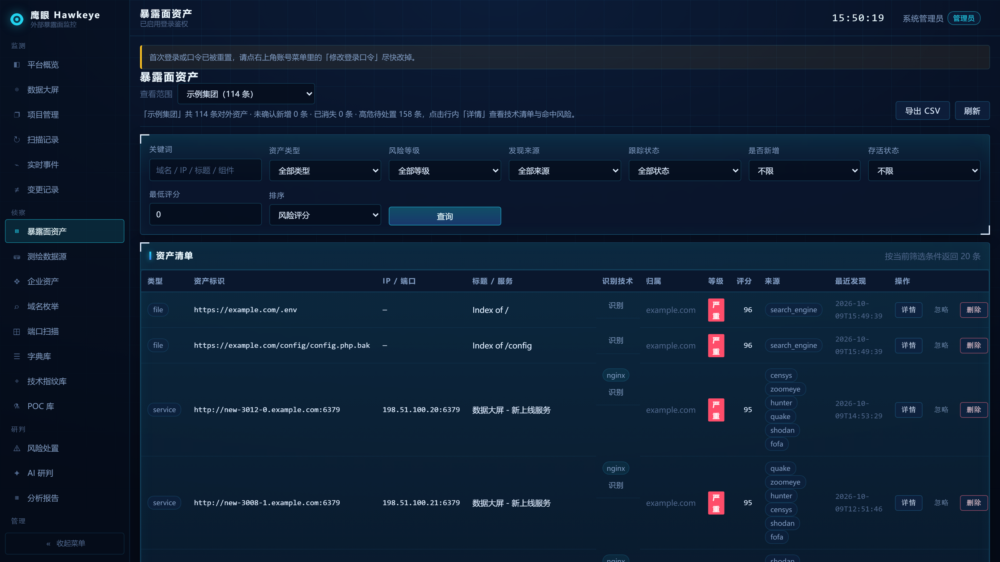

页面顶部「查看范围」切到哪家，清单、筛选字典、CSV 导出与「确认新增」就**只算这一家**；
标题那一句直接给这一家的总数 / 未确认新增 / 已消失 / 高危待处置。不选项目则看全部。

### 数据大屏：按项目出数

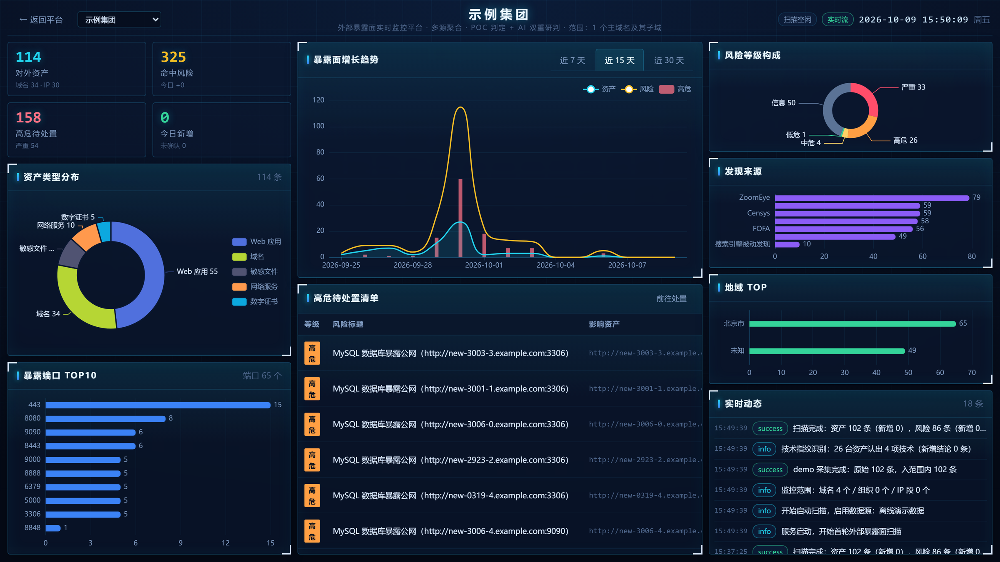

`/screen` 整屏视图：KPI + 6 张 ECharts 图 + 高危清单 + SSE 实时事件流，与平台页共用同一条流。
**默认空着**——没选项目就一个请求都不发，选到哪一家才出哪一家的数；`/screen?project=<id>` 可直接分享给别人。

### 风险处置

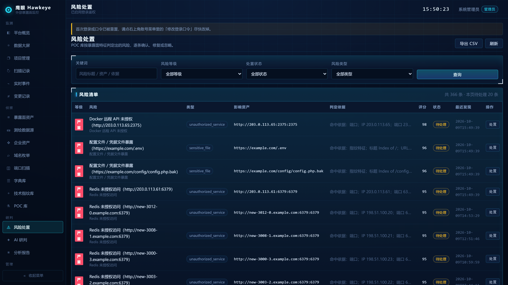

命中风险按等级 / 资产 / 来源汇总，每条都带判定依据与证据，可标记确认 / 修复 / 忽略。

### 变更记录

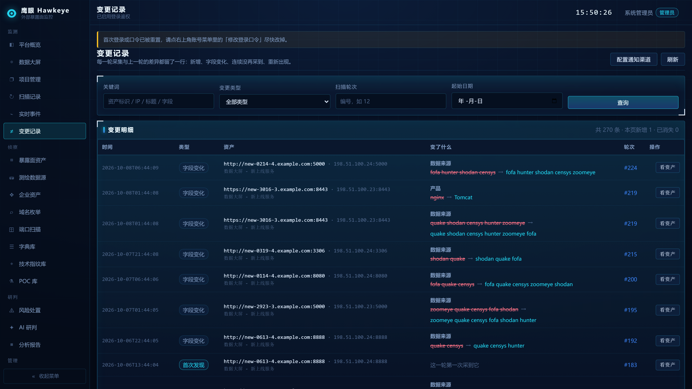

每轮采集把「谁出现、谁改了、谁不见了、谁回来了」逐字段记成流水。
「下线」按连续多少天没再采到机器判定，和人的处置状态分开存，两者不会互相覆盖。
每轮收尾可把这一轮变更推给钉钉 / 飞书 / 企业微信 / Telegram / 邮件，推送策略与渠道地址全在平台设置里。

### POC 库

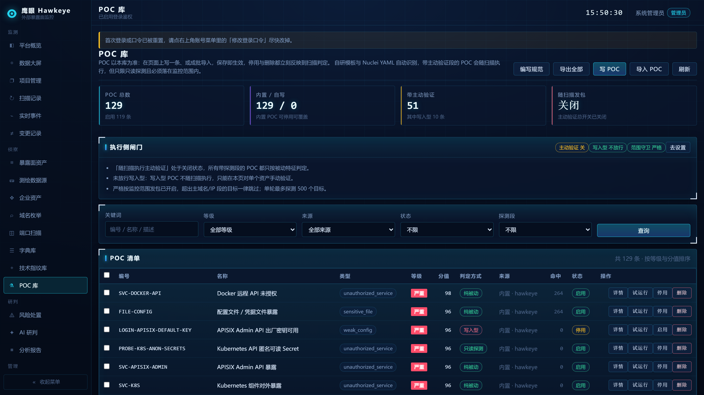

首次启动播种 **129 条内置 POC/EXP**，之后以库为准，增删改不会被升级覆盖。
页面上「写 POC」直接开模板手写、「导入 POC」支持自研 YAML 与 Nuclei YAML 混合粘贴（自动识别格式），
「仅校验」只解析这一段文本、报告字段级错误，一个包都不发也不落库；
「试跑」也只查库、只算本地字段——告诉你这条 POC 打到这台资产上会怎么走、会不会发包、会被哪道闸拦下。
导入、启停、删除与写入型的手动验证都只给管理员。

### 技术指纹库

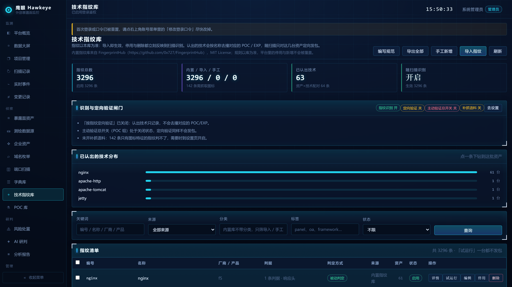

随包 **3296 条内置指纹**（来自 FingerprintHub，MIT 许可）按关键词 / 正则 / 响应头 / 图标哈希认出 Web 技术，
认出的技术再按名称 / 产品 / 厂商 / 标签定向撞对应的 POC/EXP，每台资产最多验 `fp_verify_max_rules` 条。
**识别阶段不发任何包**，页面上的「试运行」也一个包都不发。

### 端口扫描

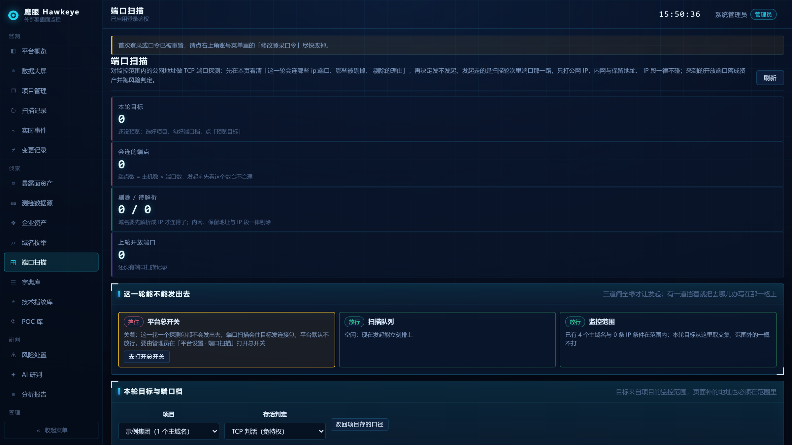

独立一页，**总开关默认关**。这一页在发包之前就能逐条看清本轮会连哪些 `ip:端口`、哪些被剔掉以及每一条的理由：
「预览目标」只按写法分类，一条 DNS 查询都不发；「解析并预览」才问解析记录。

### 域名枚举

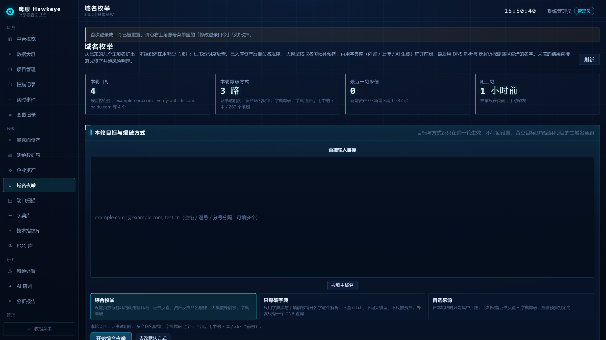

大模型按本组织命名习惯生成子域候选，再用 crt.sh 证书透明度、已入库资产反推和字典库扩线，
DNS 解析验证后并入范围——解析到 CDN 共享出口后面的名字不入库，避免把别人的资产当成自己的。
内置 **7 本按主题分好的爆破字典**（入口 / 办公 / 后台 / 研发 / 中间件 / 环境 / 云原生），也能粘贴自己的或让大模型生成一本。

### 信息收集技能

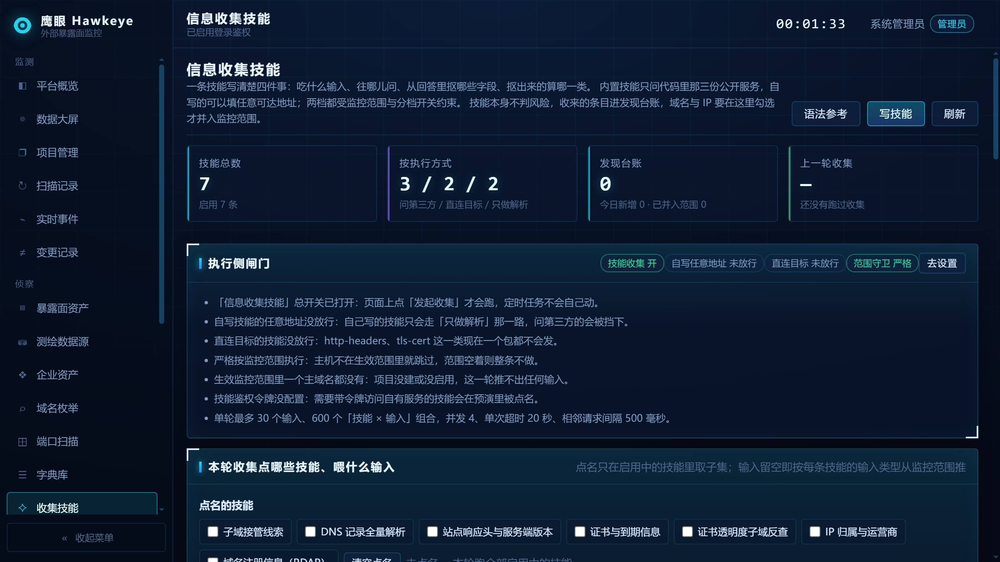

一段 YAML 写一个收集动作：给一批子域名 / 域名 / IP，按写好的问法去问一处资料，收回来的条目落进「发现台账」。
首次启动播种 **7 条内置技能**：3 条问公开服务（crt.sh / rdap.org / ip-api.com，地址钉在代码白名单上，
改成别的地址会被校验直接拒掉）、2 条只做 DNS 解析、2 条直连目标的只读探测。管理员也能自己写一条打任意地址
（云厂商元数据地址与回环无论开关开不开都拦掉），或者用「导入技能」一次贴一批——多份正文用单独一行的 `---` 分隔，
也可以直接上传 YAML 文件，逐份回显哪份够格进、哪份为什么没进；内置那几条不会被导入改动，同编号的自写技能
默认跳过、勾「覆盖同编号」才覆盖并保留它原来的启停状态。
**这一条会打到谁**写在正文的 `access` 里，三档各配一道闸：只做 DNS 解析（默认放行）、问第三方公开服务（默认放行）、
**直连目标（默认关，且输入必须落在生效监控范围里）**。
「预演」逐条列出这一轮本来会打到哪儿、被哪道闸挡住，一个包都不发也不留档案；
台账里的子域名 / 域名 / IP 由管理员一键并进监控范围，其余类型只留底。这一路**不挂定时任务**。

### 平台设置

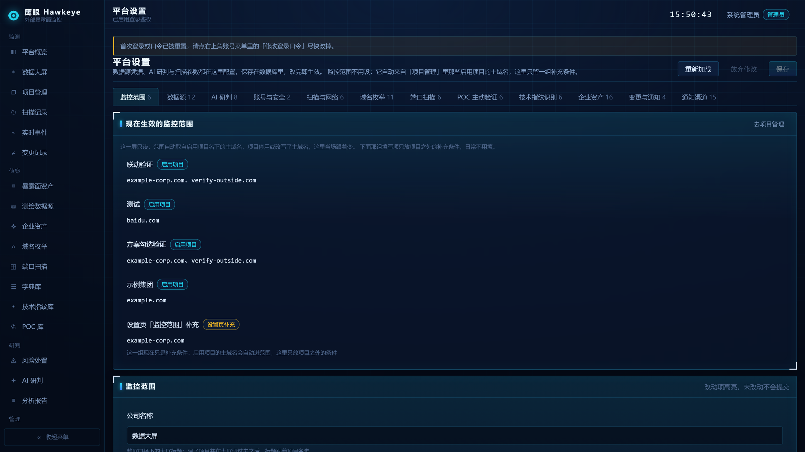

13 组配置全在这里，改完即热生效，进程级只有 5 个启动参数（监听地址 / 端口 / 库路径 / 连接串 / 日志）。
监控范围是**只读展示**——它由启用项目自动汇总，加补充条件请去项目里填，不在这页改。

---

## 主动验证的安全闸门

平台会向目标补发确认请求，因此设了硬闸门，**任何一道不过就退回被动判定**，理由在页面上逐条说明：

1. **总开关** `poc_verify_enabled`——关掉后全部 POC 只做被动匹配，一个包都不发。
2. **只读白名单**——只有声明为 `read-only` 且启用的 POC 会随扫描自动执行。
   内置 10 条写入型（匿名上传确认、Jolokia / YARN / Flink 这类 RCE 入口、默认口令尝试）**落库即为停用**；
   需带外回调的永不自动跑。写入型唯一的执行路径是管理员对**单个资产**勾选确认后手动验证。
3. **监控范围**——生效范围为空时**一律不发包**；跟跳的每一跳都过同一道闸，
   目标返回 302 想把探测包带到范围外的主机时，直接停在上一跳并记录原因。
4. **演示资产不参与主动验证**——样例域名 `example.com` 能被真实解析到，一旦落进范围就会被当成真目标，
   所以它在换探测目标那一步就直接出局。

端口扫描这一路建立的是 TCP 连接，闸门更硬：默认关；**只打公网 IP**（内网与保留地址在构造目标时剔掉并写明原因）；
`10.0.0.0/8` 这类 CIDR **不自动展开**；总开关挡着时发起按钮按住不动，回显直说「未启用」而不是假装扫过了。

信息收集技能按「这一条打到谁」分三档各配一道闸：只做解析与问公开服务默认放行（后者会让你的查询出现在对方日志里），
**直连目标（`target`）默认关**，且输入必须落在生效监控范围里；自定义地址要另开 `skill_custom_enabled`，
而云厂商元数据地址、回环与 `.local` / `.internal` **无论开关开不开都硬拦**。内置那 7 条的地址钉死在代码白名单上，改到别家当场被校验拒掉。
成批导入的正文**一律按「自写」那一档判地址**（与试跑草稿同一口径），也不会把内置那几条换掉：同编号的内置技能只回显「导入不动它」。

### 平台自己这一侧的护栏

请求体封顶 32 MB；CSV 导出转义公式写法（防 `=` 开头的单元格在分析师机器上执行）；
500 不回显表名 / SQL / 路径；跨源只认同源（不再发 `Access-Control-Allow-Origin: *`）；
`nosniff` / `X-Frame-Options: SAMEORIGIN` / `Referrer-Policy: same-origin`；
会话票据只走请求头与 HttpOnly Cookie，**没有 `?token=` 这种把长期凭据抄进浏览器历史和访问日志的通道**。

---

## 合规与免责声明

**使用这套系统就等于接受下面这几条。**它被造出来只为一件事：让一个组织在自己的资产范围内，
看见自己暴露在公网上什么。超出这个用途的用法不在本项目的许可范围内。

### 使用这一方要守的规则

1. **只碰你有权碰的资产**。监控范围里的每一个域名、每一个 IP、每一个端口都要拿得出依据：
   自有资产、书面授权、众测 / 漏洞赏金项目的 in-scope 清单、甲方给的合同附件。
   生效范围为空时系统不会自己扩大范围，越界目标会被丢弃并写明理由——但**授权证明归你，不归这套工具**，
   平台不会替你证明你有权打它。
2. **不对未授权第三方发起探测**。未经授权的扫描、探测、口令尝试与漏洞利用在多数司法辖区属于违法行为
   （中国大陆可见《网络安全法》第二十七条、《刑法》第二百八十五与二百八十六条）。
   CDN 背后不属于你的源站、第三方托管的站点、合作伙伴与供应商的资产，
   都不算「公网上能看到，所以可以打」的理由。
3. **不拿它当攻击工具**。限速、并发与单轮上限保持默认或更低，不要调到能把一个服务打停；
   内置 10 条写入型 POC（匿名上传确认、Jolokia / YARN / Flink 这类 RCE 入口、默认口令尝试）落库即为停用，
   需带外回调的永不自动跑，收集技能里直连目标那一档默认关。
   上一节那些闸门是给误操作兜底的，**不是授权的替代品**。
4. **Key、账单与收来的数据归你**。测绘引擎、企业资产上游、AI 上游用的是你自己的账号，
   遵守各家调用条款与配额，「验证一次」这类真扣费的调用由人显式触发；
   响应里可能带个人信息与凭据残片，按所在地的数据保护法规留存、脱敏、到期删除，
   导出 CSV 之前想清楚这一份要给谁、放在哪儿。
5. **结论由人负责**。POC 判定会误报也会漏报，AI 研判是概率输出不是事实认定，
   技术指纹认的是组件而非可利用性。页面上的任何一条都不构成「已经安全」或「确实有洞」的证明，
   判断、处置与签字的责任在那个组织和那个人。

### 项目这一侧的立场

- 本项目**不提供、不鼓励、不接受**任何绕过授权确认或使用闸门的手段，也不为任何使用行为背书。
- 对使用本工具（含修改源码、二次分发、集成进别的系统之后使用）造成的任何后果**不承担责任**，
  包括但不限于服务中断、数据泄露、账号封禁、上游封 Key、被追责或诉讼。
- 内部推广或再分发这套产物时，请**连同本节一起交出去**，并由使用单位自行完成合规审查。
- 平台自带的操作审计、生效范围校验与越界拒绝只用于团队自查，**不构成法律意义上的授权证明**。

截图与示例里的 `example.com`、`198.51.100.x`、`203.0.113.x` 全部是保留域 / 文档用地址，来自内置的离线演示源，
**不是真实目标**。演示源默认关闭，全新安装启动后不会自动长出假资产。

---

## 采集来源与上游

| 类别 | 已接入 |
| --- | --- |
| 暴露面测绘 | FOFA、奇安信 Hunter、360 Quake、ZoomEye、Shodan、Censys、搜索引擎被动发现、离线演示源（共 8 路） |
| 企业资产 | 天眼查、企查查、自定义企业数据源（工商登记 + ICP 备案域名 + App / 小程序 / 公众号） |
| AI 研判 | OpenAI 兼容 `/chat/completions` 与 Anthropic `/v1/messages` 两套协议，一份配置切 DeepSeek / 通义 / Kimi / 智谱 / Anthropic / OpenRouter / Ollama / vLLM；未配 Key 自动降级为本地规则研判 |
| 通知 | 钉钉、飞书、企业微信、Telegram、邮件 |
| 收集技能 | 内置 7 条：3 条问白名单公开服务（crt.sh 证书透明度、rdap.org 注册信息、ip-api.com 归属）、2 条只做 DNS 解析（记录全量解析、子域接管线索）、2 条直连目标的只读探测（响应头、TLS 证书，默认闸门关着）；自定义技能可填任意 http/https 地址 |

7 路需要凭据的采集来源与 3 路企业资产上游都有**接入检测**：`GET /api/keys/check` 只看配置，一个包都不发；
要确认 Key 本身对不对才点「验证一次」——那一发会真的计费（测绘引擎扣查询点数、工商接口按次计），
所以只由人显式触发并写进操作审计。

---

## 命令行运维

都在同一个二进制里，读同一份数据库，动作全部记进操作审计（操作者记为「命令行」）：

```bash
hawkeye check-db                       # 连接与建表自检，报告各表数据量与账号数
hawkeye list-users                     # 列出所有账号（角色 / 状态 / 最近登录）
hawkeye create-user ops01 -role operator -display-name 运维一号
hawkeye reset-admin admin              # 重置口令；账号库为空时直接创建初始管理员
hawkeye set-role ops01 -role viewer    # 调整角色
hawkeye sync-rules                     # 升级后把新增的内置 POC 补进老库
```

---

## 本目录内容

| 文件 | 说明 |
| --- | --- |
| `hawkeye-linux-amd64` / `hawkeye-linux-arm64` | Linux x86_64 / ARM64（含麒麟、统信等信创发行版） |
| `hawkeye-darwin-amd64` / `hawkeye-darwin-arm64` | Intel Mac / Apple 芯片 Mac |
| `hawkeye-windows-amd64.exe` | Windows 10 / 11 / Server 2016+ 64 位 |

五个单文件的 sha256 列在 [`使用说明.md` 第一节](使用说明.md)，下载后请先核对再运行。

---

## 许可与第三方

- 内置技术指纹库来自 **FingerprintHub**（MIT），许可证与出处随包分发，并在「技术指纹库」页标注；
- POC 规则库为本项目自研格式，兼容导入 Nuclei YAML；
- 各测绘引擎、企业数据源、AI 上游的接口与数据归其权利人所有，本项目不内置任何第三方 Key。

## 版本

`0.0.1` 是首个公开版本。版本号在 `/api/health`、平台概览与启动日志里回显；
升级只需换二进制，建表与迁移在下次启动时自动跑（迁移只加表加列，不会删东西，但动手前请先备份数据库）。
